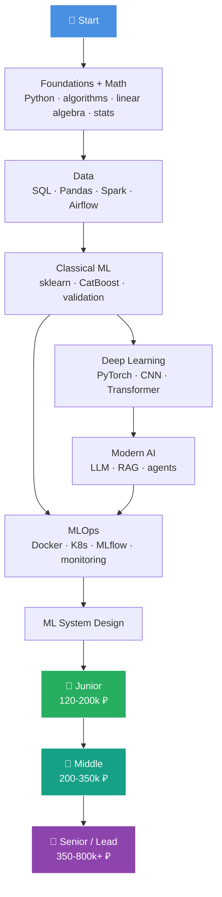
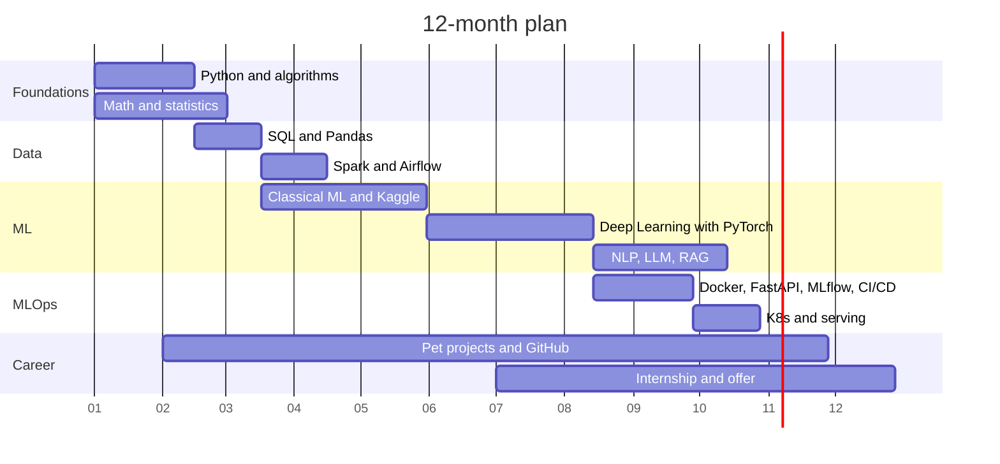

<div align="center">

# 🤖 ML Engineer Roadmap 2026

### The path to an ML Engineer offer in the Russian job market

[Русский](README.md) · **English**


[Sections](#sections) · [Where to start](#where-to-start) · [ML Coach](#ml-coach-interview-trainer) · [12-month plan](#12-month-plan) · [Salaries](#salaries) · [Interview checklist](#interview-checklist) · [Contributing](#contributing)

</div>

---

## About

I'm putting this roadmap together while going down the ML Engineer path myself. I wanted one clear route instead of "learn everything": which stack Russian companies actually use, where to apply, what they ask in interviews, and what to read.

Every section is a checklist. Tick things off as you go. At the bottom of each page there are "back" and "next" links, so it reads like a book.

There is also [ML Coach](#ml-coach-interview-trainer): a skill for terminal AI agents that checks your level, builds a study plan and runs mock interviews based on this roadmap.

---

## Sections

| # | Section | Time |
|---|---|:---:|
| 1 | 🐍 [Foundations: Python, algorithms, CS](docs/en/01_foundations.md) | 1-2 months |
| 2 | 📐 [Math for ML](docs/en/02_math.md) | in parallel |
| 3 | 🗄️ [Data Engineering for ML](docs/en/03_data.md) | 1-2 months |
| 4 | 🤖 [Classical ML](docs/en/04_classical_ml.md) | 2-3 months |
| 5 | 🧠 [Deep Learning](docs/en/05_deep_learning.md) | 2-3 months |
| 6 | 💬 [Modern AI: NLP, LLM, RAG, agents](docs/en/06_modern_ai.md) | 2-3 months |
| 7 | ⚙️ [MLOps and production](docs/en/07_mlops.md) | 2 months |
| 8 | 🏗️ [ML System Design](docs/en/08_system_design.md) | 1 month |
| 9 | 💼 [Career in the Russian market](docs/en/09_career.md) | ongoing |
| 10 | 🎯 [Pet projects and portfolio](docs/en/10_projects.md) | ongoing |
| 11 | 📖 [Resources and books](docs/en/11_resources.md) | - |

---

## Where to start

| If you... | Start here |
|---|---|
| are just starting | [1. Foundations](docs/en/01_foundations.md) and [2. Math](docs/en/02_math.md) in parallel |
| already write Python and know ML basics | [4. Classical ML](docs/en/04_classical_ml.md), then [5. Deep Learning](docs/en/05_deep_learning.md) |
| want to work with LLMs | [6. Modern AI](docs/en/06_modern_ai.md) and projects from [10. Pet projects](docs/en/10_projects.md) |
| have an interview soon | [interview checklist](#interview-checklist), [8. ML System Design](docs/en/08_system_design.md) and a mock interview with [ML Coach](#ml-coach-interview-trainer) |
| don't know your level | ML Coach, "check my level" mode |

---

## ML Coach: interview trainer

A skill for terminal AI agents (Claude Code, Codex and others that support the `SKILL.md` format). Works in Russian and English.

What it does:

- **Level check.** A short conversation across the roadmap sections. You get a table with your level per section and your three weakest spots.
- **Study plan.** A week-by-week plan for your hours per week and deadline, with resources from the roadmap.
- **Mock interview.** ML theory, DL and LLM, MLOps, ML system design (8 cases: recommendations, search, antifraud, a RAG bot for a bank and more) or ML coding. One question at a time with follow-ups, like a real interview, then a debrief with scores.
- **Section quiz.** 5-8 quick questions with explanations right away.
- **Progress.** Results are saved to a file, and weak topics come back in later sessions until you close them.

### Install

Copy this and send it to your agent:

```
Install the ML Coach skill following these instructions: https://raw.githubusercontent.com/vincere-mori/ml-engineer-roadmap/main/INSTALL.md
```

The agent figures out where to put it. It only downloads the repo and copies one folder, you can read the instructions [here](INSTALL.md).

<details>
<summary>Install manually</summary>

**Claude Code**, inside a session:

```
/plugin marketplace add vincere-mori/ml-engineer-roadmap
/plugin install ml-roadmap@ml-engineer-roadmap
```

**Codex** (and other agents with skills), in a terminal:

```bash
git clone --depth 1 https://github.com/vincere-mori/ml-engineer-roadmap.git
mkdir -p ~/.agents/skills && cp -r ml-engineer-roadmap/plugins/ml-roadmap/skills/ml-coach ~/.agents/skills/
```

</details>

### Usage

Just tell the agent what you want:

- "Check my ML level"
- "Run an ML system design mock interview, Middle level"
- "Quiz me on gradient boosting"
- "Make a plan to get an internship by June, I have 10 hours a week"

In Claude Code you can also call it directly: `/ml-roadmap:ml-coach`.

---

## Map



---

## 12-month plan

A rough plan for 15-20 hours a week. The axis shows the month number.



---

## Salaries

| Grade | Experience | Moscow, gross / month | Regions |
|---|:---:|:---:|:---:|
| 👶 Intern | 0 | 60-120k ₽ | 40-80k ₽ |
| 🚀 Junior | 0-1 year | 120-200k ₽ | 90-150k ₽ |
| ⚡ Middle | 2-3 years | 200-350k ₽ | 150-280k ₽ |
| 🔥 Senior | 4-6 years | 350-600k ₽ | 250-450k ₽ |
| 👑 Lead / Staff | 6+ years | 600k-1M+ ₽ | 400-700k ₽ |

> Rough ranges as of 2026. Real numbers swing a lot by company, grade and stack, and LLM/CV roles usually pay above average. Check fresh data before negotiating: [Habr Career salaries](https://career.habr.com/salaries), [getmatch](https://getmatch.ru), [hh.ru](https://hh.ru).

### Who hires

| 🥇 Tier-1 | 🥈 Tier-2 | 🥉 Tier-3 |
|:---:|:---:|:---:|
| Yandex (Search, Alice, Shedevrum) | Avito | Wildberries |
| Sber / SberAI (GigaChat, Kandinsky) | Ozon | X5 Tech |
| T-Bank | MTS AI / MWS | Alfa-Bank |
| VK (VK Tech, Marusia) | Kaspersky | Gazprombank |
| | Skoltech / AIRI | VTB, Sovcombank |

---

## Interview checklist

- [ ] Python: OOP, async, typing, tests (`pytest`)
- [ ] Algorithms: ~150 LeetCode Easy/Medium problems
- [ ] SQL: window functions, optimization, EXPLAIN
- [ ] Math: linear algebra, calculus, probability, statistics
- [ ] Classical ML: bias/variance, regularization, how boosting works inside
- [ ] Deep Learning: implemented backprop, CNN, Transformer by hand
- [ ] PyTorch: can write a train loop without copy-paste
- [ ] LLM: attention, KV-cache, RAG, LoRA, evals, agents and MCP
- [ ] MLOps: deployed a model with Docker + FastAPI + monitoring
- [ ] System Design: worked through 3+ cases (recommendations, search, antifraud, NLP service)
- [ ] Portfolio: 2-3 strong pet projects on GitHub
- [ ] Kaggle: at least one bronze medal
- [ ] Resume on hh, getmatch and Habr Career

---

## How to use this repo

1. Go through the sections **in order**, but study math and algorithms **in parallel**.
2. Back every topic with a **project**, ideas are in [10. Pet projects](docs/en/10_projects.md).
3. Track progress: fork the repo and fill in [PROGRESS.en.md](PROGRESS.en.md), or let [ML Coach](#ml-coach-interview-trainer) keep it for you.
4. Most resources are in Russian and aimed at the Russian market.

---

## Contributing

Found a dead link, an outdated tool, or know a great resource that's missing? Open an [issue](https://github.com/vincere-mori/ml-engineer-roadmap/issues/new/choose) or send a PR, see [CONTRIBUTING.en.md](CONTRIBUTING.en.md). Links are checked automatically once a month.

## License

The text is licensed under [CC BY-SA 4.0](LICENSE): you can copy, translate and remix it, just credit this repo and keep the same license.

---

<div align="center">

**If the roadmap helped you, give it a ⭐ so more people can find it**

</div>
