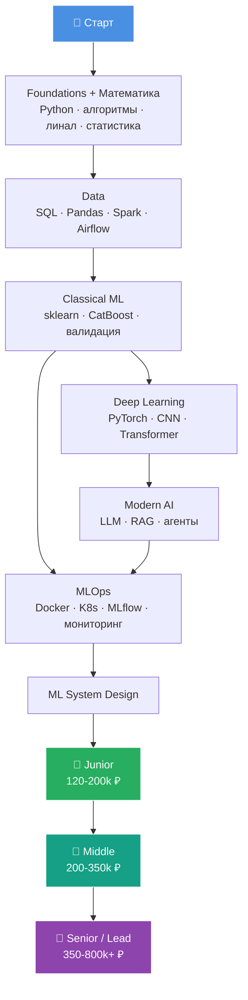
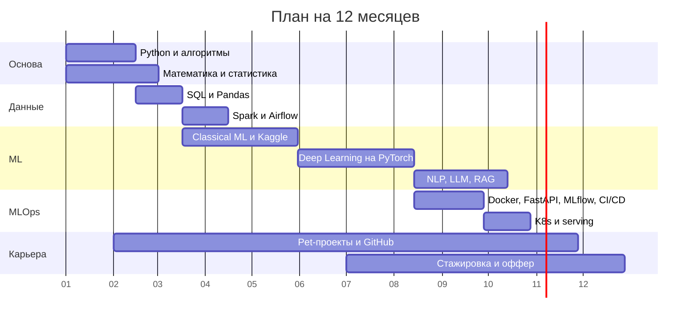

<div align="center">

# 🤖 ML Engineer Roadmap 2026

### Путь до оффера ML-инженера на российском рынке

**Русский** · [English](README.en.md)


[Разделы](#разделы) · [С чего начать](#с-чего-начать) · [ML Coach](#ml-coach-тренер-для-собесов) · [План на год](#план-на-год) · [Зарплаты](#зарплаты) · [Чек-лист к собесу](#чек-лист-к-собесу) · [Как помочь](#как-помочь)

</div>

---

## О роудмапе

Один понятный маршрут до оффера ML-инженера без «изучите всё». Здесь собрано то, что реально нужно на российском рынке: какой стек используют в компаниях, куда подаваться, что спрашивают на собесах и что читать.

Каждый раздел это чек-лист. Отмечай пункты по ходу, а внизу каждой страницы есть ссылки «назад» и «далее», так что читается как книга.

Ещё есть [ML Coach](#ml-coach-тренер-для-собесов): скилл для AI-агентов в терминале, который проверяет уровень, составляет план и гоняет по пробным собесам на материале роудмапа.

---

## Разделы

| # | Раздел | Сколько времени |
|---|---|:---:|
| 1 | 🐍 [Foundations: Python, алгоритмы, CS](docs/ru/01_foundations.md) | 1-2 мес |
| 2 | 📐 [Математика для ML](docs/ru/02_math.md) | параллельно |
| 3 | 🗄️ [Data Engineering для ML](docs/ru/03_data.md) | 1-2 мес |
| 4 | 🤖 [Classical ML](docs/ru/04_classical_ml.md) | 2-3 мес |
| 5 | 🧠 [Deep Learning](docs/ru/05_deep_learning.md) | 2-3 мес |
| 6 | 💬 [Modern AI: NLP, LLM, RAG, агенты](docs/ru/06_modern_ai.md) | 2-3 мес |
| 7 | ⚙️ [MLOps и прод](docs/ru/07_mlops.md) | 2 мес |
| 8 | 🏗️ [ML System Design](docs/ru/08_system_design.md) | 1 мес |
| 9 | 💼 [Карьера на рынке РФ](docs/ru/09_career.md) | всё время |
| 10 | 🎯 [Pet-проекты и портфолио](docs/ru/10_projects.md) | всё время |
| 11 | 📖 [Ресурсы и книги](docs/ru/11_resources.md) | - |

---

## С чего начать

| Если ты... | Начни отсюда |
|---|---|
| только начинаешь | [1. Foundations](docs/ru/01_foundations.md) и параллельно [2. Математика](docs/ru/02_math.md) |
| уже пишешь на Python и знаешь основы ML | [4. Classical ML](docs/ru/04_classical_ml.md), потом [5. Deep Learning](docs/ru/05_deep_learning.md) |
| хочешь в LLM | [6. Modern AI](docs/ru/06_modern_ai.md) и проекты из [10. Pet-проекты](docs/ru/10_projects.md) |
| скоро собес | [чек-лист к собесу](#чек-лист-к-собесу), [8. ML System Design](docs/ru/08_system_design.md) и пробный собес в [ML Coach](#ml-coach-тренер-для-собесов) |
| не понимаешь, какой у тебя уровень | ML Coach в режиме «проверить уровень» |

---

## ML Coach: тренер для собесов

Скилл для AI-агентов в терминале (Claude Code, Codex и другие, которые понимают формат `SKILL.md`). Работает на русском и английском.

Что умеет:

- **Проверить уровень.** Короткий разговор по разделам роудмапа, в конце таблица с уровнем по каждому разделу и тремя самыми слабыми местами.
- **Составить план.** Понедельный план под твои часы в неделю и дедлайн, с ресурсами из роудмапа.
- **Пробный собес.** ML-теория, DL и LLM, MLOps, ML system design (8 кейсов: рекомендации, поиск, антифрод, RAG-бот для банка и другие) или ML-кодинг. Вопрос за вопросом, с уточнениями, как на реальном собесе, а в конце разбор с оценкой.
- **Квиз по разделу.** 5-8 быстрых вопросов с объяснениями сразу.
- **Прогресс.** Результаты сохраняются в файл, слабые темы возвращаются в следующих сессиях, пока не закроешь.

### Установка

Скопируй и отправь своему агенту:

```
Установи скилл ML Coach по инструкции: https://raw.githubusercontent.com/vincere-mori/ml-engineer-roadmap/main/INSTALL.md
```

Агент сам поймёт, куда его ставить. Он только скачает репозиторий и скопирует одну папку, инструкцию можно посмотреть [тут](INSTALL.md).

<details>
<summary>Установить вручную</summary>

**Claude Code**, внутри сессии:

```
/plugin marketplace add vincere-mori/ml-engineer-roadmap
/plugin install ml-roadmap@ml-engineer-roadmap
```

**Codex** (и другие агенты со скиллами), в терминале:

```bash
git clone --depth 1 https://github.com/vincere-mori/ml-engineer-roadmap.git
mkdir -p ~/.agents/skills && cp -r ml-engineer-roadmap/plugins/ml-roadmap/skills/ml-coach ~/.agents/skills/
```

</details>

### Как пользоваться

Просто напиши агенту, что хочешь:

- «Проверь мой уровень по ML»
- «Устрой мне собес по ML system design на мидла»
- «Квиз по бустингам»
- «Составь план до стажировки к июню, у меня 10 часов в неделю»

В Claude Code можно вызвать и напрямую: `/ml-roadmap:ml-coach`.

---

## Карта



---

## План на год

Примерно, при 15-20 часах в неделю. По оси номер месяца.



---

## Зарплаты

| Грейд | Опыт | Москва, gross / мес | Регионы |
|---|:---:|:---:|:---:|
| 👶 Стажёр | 0 | 60-120k ₽ | 40-80k ₽ |
| 🚀 Junior | 0-1 год | 120-200k ₽ | 90-150k ₽ |
| ⚡ Middle | 2-3 года | 200-350k ₽ | 150-280k ₽ |
| 🔥 Senior | 4-6 лет | 350-600k ₽ | 250-450k ₽ |
| 👑 Lead / Staff | 6+ лет | 600k-1M+ ₽ | 400-700k ₽ |

> Грубые вилки на 2026 год. Реальные цифры сильно гуляют по компании, грейду и стеку, а LLM и CV обычно платят выше среднего. Перед торгом смотри свежие данные: [зарплаты на Хабр Карьере](https://career.habr.com/salaries), [getmatch](https://getmatch.ru), [hh.ru](https://hh.ru).

### Кто нанимает

| 🥇 Tier-1 | 🥈 Tier-2 | 🥉 Tier-3 |
|:---:|:---:|:---:|
| Яндекс (Поиск, Алиса, Шедеврум) | Avito | Wildberries |
| Сбер / SberAI (GigaChat, Kandinsky) | Ozon | X5 Tech |
| Т-Банк | MTS AI / MWS | Альфа-Банк |
| VK (VK Tech, Маруся) | Лаборатория Касперского | Газпромбанк |
| | Сколтех / AIRI | ВТБ, Совкомбанк |

---

## Чек-лист к собесу

- [ ] Python: ООП, async, типизация, тесты (`pytest`)
- [ ] Алгоритмы: ~150 задач LeetCode Easy/Medium
- [ ] SQL: оконные функции, оптимизация, EXPLAIN
- [ ] Математика: линал, матан, теорвер, статистика
- [ ] Classical ML: bias/variance, регуляризация, как устроены бустинги
- [ ] Deep Learning: руками писал backprop, CNN, Transformer
- [ ] PyTorch: пишу train loop без копипасты
- [ ] LLM: attention, KV-cache, RAG, LoRA, evals, агенты и MCP
- [ ] MLOps: задеплоил модель с Docker + FastAPI + мониторингом
- [ ] System Design: разобрал 3+ кейса (рекомендации, поиск, антифрод, NLP-сервис)
- [ ] Портфолио: 2-3 сильных pet-проекта на GitHub
- [ ] Kaggle: хотя бы одна бронза
- [ ] Резюме на hh, getmatch и Хабр Карьере

---

## Как пользоваться

1. Иди по разделам **по порядку**, а математику и алгоритмы качай **параллельно**.
2. Каждую тему закрепляй **проектом**, идеи в [10. Pet-проекты](docs/ru/10_projects.md).
3. Веди прогресс: форкни репозиторий и заполняй [PROGRESS.md](PROGRESS.md), или пусть его ведёт [ML Coach](#ml-coach-тренер-для-собесов).
4. Ресурсы в основном на русском и под российский рынок.

---

## Как помочь

Нашёл битую ссылку, устаревший инструмент или знаешь классный ресурс, которого тут нет? Открой [issue](https://github.com/vincere-mori/ml-engineer-roadmap/issues/new/choose) или пришли PR, подробности в [CONTRIBUTING.md](CONTRIBUTING.md). Ссылки проверяются автоматически раз в месяц.

## Лицензия

Тексты под [CC BY-SA 4.0](LICENSE): можно копировать, переводить и переделывать, главное указать ссылку на этот репозиторий и оставить ту же лицензию.

---

<div align="center">

**Если роудмап пригодился, поставь ⭐, так его увидит больше людей**

</div>
